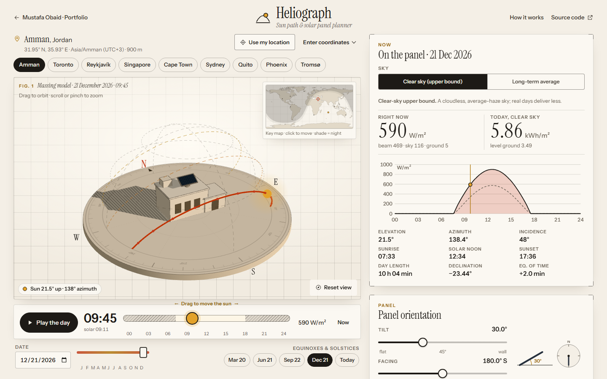

# Heliograph — sun path and solar panel planner

Track the Sun anywhere on Earth, draw the buildings and trees around you on a sun-path diagram,
and find the tilt and direction that collect the most energy, with and without that shading.

**Live demo:** https://mustafaobaidd1.github.io/heliograph-solar/



## The question

Where is the Sun at any moment, and which way should a solar panel face to collect the most
energy at a given place, with and without shading? Heliograph answers it three ways at once. A 3D
"architect's massing model" shows the Sun and its shadows. A stereographic sun-path diagram doubles
as a skyline editor. The full tilt × azimuth energy landscape shows how forgiving the choice is.

Heliograph is a **planning calculator built on published models**, not a yield guarantee. Its
default clear-sky numbers are an **upper bound**. A second mode rescales them to NASA POWER's
long-term monthly averages for a typical year.

## Features

- **3D massing model** (three.js): matte clay house with a pedestal-mounted panel on an engraved
  compass plate, the Sun's daily arc on a sky dome (solstice and equinox arcs dashed), screen-space
  **hatched shadows**, a moonlit night state, and the skyline drawn as ghosted context blocks that
  cast real shadows. Orbit and zoom; the camera fits the model to any screen. Without WebGL, a 2D
  site plan draws the same shadows analytically.
- **Time and date**: a large time-of-day scrubber (night hatched on its track, ←/→ = 5 min,
  Shift = 1 h), a day-of-year scrubber, a date picker, solstice/equinox jumps and **Play the day**
  (hour-by-hour steps under reduced motion). On first load the Sun rises to "now". At night the
  model opens on a daytime moment and says so.
- **Places**: nine presets (Amman, Toronto, Reykjavík, Singapore, Cape Town, Sydney, Quito, Phoenix
  and Tromsø for the midnight sun), typed latitude/longitude/IANA time zone/altitude with
  validation, **Use my location** (asked only on click), and a Natural Earth key map with the
  live day/night terminator. Click it to move there.
- **Sun position** after NOAA/Meeus: declination, equation of time, refracted elevation, azimuth,
  sunrise, solar noon, sunset and day length, with polar day and night detected and explained ("It
  first sets again on 26 Jul at 00:36").
- **Sun-path diagram** (SVG, stereographic): monthly day lines, figure-eight hour analemmas in local
  standard time, the selected day and the Sun. **Draw the skyline** with the pointer (or erase it),
  or edit it as a keyboard-friendly table of azimuth/elevation points. Examples are included. Parts
  of the day path behind the skyline are dashed.
- **Irradiance**: extraterrestrial 1361 W/m² × (1 AU/r)², the simplified Solis clear sky with
  editable aerosol depth, precipitable water and altitude, and transposition by **Perez 1990** or
  **Hay–Davies**, plus ground reflection with selectable albedo.
- **Long-term averages**: NASA POWER 2001–2020 monthly normals, bundled for the presets, fetched
  live (CORS) and cached for anywhere else. A failure falls back to clear sky with a retry button.
- **Optimiser** in a Web Worker: period energy over 37 × 72 orientations (tilt 0–90°, azimuth
  0–355°), isolines at 50–98 % of the optimum, golden-section refinement, the optimum with and
  without the skyline, a 95 % tolerance range, and live slices through your panel. Click or drag
  the map (or use arrow keys) to move the panel. Periods: year, summer, winter or a custom range.
- **Strategy comparison**: latitude rule of thumb, optimum fixed, re-tilt twice and four times a
  year, single-axis and two-axis trackers, with % gain over the best fixed panel (outlined bars show
  the open-horizon value when a skyline is drawn).
- **PV estimate**: kWp, temperature coefficient, NOCT cell temperature, 14 % default system losses
  and incidence-angle losses give kWh/year, specific yield, performance ratio, shading loss and
  monthly bars.
- **Export and share**: hourly CSV for the whole year (8,760 rows of sun position, GHI/DNI/DHI,
  plane-of-array parts, cell temperature and AC power) with an on-page preview. The URL holds the
  full state, so a copied link restores the exact view.
- **How it works**: every equation (KaTeX), assumptions, limitations, references and a validation
  table regenerated by `npm run validate`.

## How it works

Everything runs in the browser. Angles are in degrees, irradiance in W/m², energy in kWh/m² (or
kWh for the PV estimate), time in the place's IANA time zone.

1. **Sun position.** The NOAA GML solar-calculator algorithm (Meeus, _Astronomical Algorithms_):
   from Julian centuries `T` it computes the mean longitude `L₀`, anomaly `M`, equation of centre,
   apparent longitude `λ`, obliquity `ε`, then `δ = asin(sin ε sin λ)` and the equation of time
   `E = 4[y sin 2L₀ − 2e sin M + 4ey sin M cos 2L₀ − ½y² sin 4L₀ − 1.25e² sin 2M]` minutes,
   `y = tan²(ε/2)`. Hour angle `h = TST/4 − 180°`; `cos θz = sin φ sin δ + cos φ cos δ cos h`;
   azimuth by `atan2`; NOAA's refraction fit for elevation. Sunrise and sunset are crossings of the
   90.833° geometric zenith, the condition NOAA solves with `cos h₀`. Heliograph samples the
   noon-centred day every 10 minutes (both midnights and noon included) and refines each crossing
   by bisection, so it also handles polar transition days, when the Sun dips below the horizon for
   minutes. No crossing means polar day or night.
2. **Clear sky.** Simplified Solis (Ineichen 2008):
   `DNI = I₀′ exp(−τb / sin^b α)`, `DHI = I₀′ exp(−τd / sin^d α)`, with `I₀′`, `τ`, `b`, `d`
   from aerosol optical depth at 700 nm, precipitable water and pressure (standard atmosphere from
   altitude). Solis fits GHI separately. Its three outputs miss closure by up to ~14 W/m², so
   `GHI = DNI sin α + DHI` is enforced and a horizontal plane receives exactly GHI.
3. **Transposition.** `G = DNI·max(0, cos θ)·V☉ + D_sky + ρ·GHI·(1 − cos β)/2`. Perez:
   `D_sky = DHI[(1 − F₁)F_sky + F₁·a/b + F₂ sin β]` with the 1990 all-sites coefficients, sky
   clearness `ε`, brightness `Δ` (Kasten–Young air mass), `a = max(0, cos θ)`,
   `b = max(cos 85°, cos θz)`. Hay–Davies: `D_sky = DHI[Aᵢ R_b + (1 − Aᵢ)(1 + cos β)/2]`.
4. **Skyline shading.** The skyline is a closed polyline of (azimuth, elevation) points joined by
   straight lines through north (the PVGIS/PVsyst convention). Beam and circumsolar light are
   blocked when the Sun is below it (`V☉ = 0`). The isotropic sky loses the part of the dome the
   tilted panel can no longer see, `F_sky = (1 + cos β)/2 − (1/π)∬ max(0, n̂·ŝ) cos e de dφ`,
   integrated analytically in elevation for each 1° azimuth sector. The Perez horizon band is
   scaled by its visible fraction.
5. **Optimisation.** Everything independent of the panel (sun vector, components, Perez `F₁`/`F₂`,
   skyline visibility, air temperature) is computed once per 15-minute step (midpoint sampling,
   daylight only) into a year table, ~17,700 steps for Amman. One orientation is then a dot product
   and a few multiply-adds per step. The whole analysis, including the 37 × 72 grid (2.5° × 5°),
   takes about half a second on a desktop browser, and nested
   golden-section searches (azimuth outside, tilt inside, ±2 grid steps, to 0.01°) refine the best
   cell. Re-tilt optimises each season's tilt at the optimum azimuth, and the mount may tip either
   way about its east–west axis, which matters at the equator. Seasons switch on 20 Mar/22 Sep (2×)
   or on the cross-quarter days 4 Feb, 6 May, 7 Aug and 6 Nov (4×). The single-axis tracker turns
   about a horizontal north–south axis to `R = atan2(sx, sz)`, limited to ±60°, without
   backtracking. The two-axis tracker faces the Sun.
6. **PV estimate.** `Tc = Ta + (NOCT − 20 °C)/800 W m⁻² · G` and
   `P = P_STC · G_eff/1000 · [1 + γ(Tc − 25 °C)] · (1 − L)`, where `G_eff` applies the ASHRAE
   incidence-angle modifier `1 − b₀(1/cos θ − 1)`, `b₀ = 0.05`, to beam and circumsolar light. Air
   temperature is constant in clear-sky mode. With NASA POWER normals it follows
   `T2M + ½·T2M_RANGE·cos(2π(t − 15 h)/24)`.
7. **Long-term averages.** Each month's clear-sky diffuse and beam are scaled to NASA POWER's
   monthly diffuse and GHI − diffuse, so monthly GHI and diffuse match POWER exactly. POWER's own DNI
   is deliberately not used. In the tropics it is inconsistent with its GHI and diffuse: for
   Singapore the implied DNI-weighted mean cos θz is 0.94–1.17, which is impossible.

## Validation

Kind of tool: a **planning calculator**. The sun position is validated against NOAA, JPL Horizons
and USNO, and the irradiance models reproduce pvlib-python's regression values. The optimiser was
compared against PVGIS 5.3 and the Jacobson & Jadhav (2018) fit. Energy and PV numbers are
model estimates, not measurements. All checks below run in the unit tests. `npm run validate`
regenerates these tables and the in-app copy (`src/data/validation.json`).

**Sun position vs the NOAA Solar Calculator** (values displayed by the live page,
gml.noaa.gov/grad/solcalc, read 2026-10-06; the brief's targets are ±0.1° and ±1 min):

| Case                       | Elevation NOAA / here | Azimuth NOAA / here | Sunrise NOAA / here | Sunset NOAA / here | Solar noon NOAA / here |
| -------------------------- | --------------------- | ------------------- | ------------------- | ------------------ | ---------------------- |
| Amman 2026-06-21 12:00     | 78.04° / 78.036°      | 132.97° / 132.967°  | 05:31 / 05:30:49    | 19:45 / 19:45:21   | 12:37:58 / 12:38:05    |
| Greenwich 2026-03-20 12:00 | 38.48° / 38.476°      | 177.63° / 177.626°  | 06:03 / 06:02:52    | 18:13 / 18:13:00   | 12:07:35 / 12:07:26    |
| Quito 2026-12-21 12:00     | 66.57° / 66.567°      | 173.04° / 173.037°  | 06:08 / 06:07:59    | 18:16 / 18:16:08   | 12:11:48 / 12:12:03    |

Elevation and azimuth agree to the page's 0.01° display, and sunrise and sunset to within a second
of NOAA's unrounded values. Solar noon differs by up to 15 s: NOAA's `calcSolNoon` evaluates the
equation of time half a day early (it treats the midnight Julian date as noon), whereas we evaluate
it at noon. USNO's transit times (12:38, 12:07, 12:12) agree with ours.

**Independent references.** JPL Horizons apparent refracted az/el for four cases agrees within
0.0066° (largest Δ). USNO rise/set for the same three dates is identical to the minute. Reykjavík on
21 June still sets (00:04, rises 02:55) and Tromsø's 2026 midnight sun runs 19 May – 25 July,
exactly the dates USNO reports. The transition-day events (18 May 00:53, 26 July 00:36) agree within
2 minutes, which is close for a Sun skimming the horizon at 70° N.

**Calendar checks.** Over 2026 the declination stays within ±23.44° and the equation of time peaks
at +16.4 min (early November) and −14.2 min (mid February), each within 0.15 min.

**Irradiance models vs pvlib-python's own test vectors** (largest absolute difference):
simplified Solis 3.3 × 10⁻⁷ W/m² (GHI/DNI/DHI, five cases across aerosol depth, water and pressure),
Perez 1990 sky diffuse 0.0044 W/m², Hay–Davies 3.8 × 10⁻⁵ W/m². A tilt-0 plane receives exactly
GHI, a panel facing the Sun receives exactly DNI as beam, and night gives zero. The obstructed
sky-view factor matches closed forms (horizontal plane under a uniform 30° skyline: cos² 30° = 0.75)
and brute-force integration to 0.004.

**Optimum fixed tilt** (equator-facing, 2026), against PVGIS 5.3 (optimal inclination, queried
2026-10-06) and the Jacobson & Jadhav (2018) cubic fit to PVWatts optima:

| Place     | Lat     | PVGIS 5.3 | J&J fit | Here, NASA POWER normals | Here, clear sky | PVGIS angle captures |
| --------- | ------- | --------- | ------- | ------------------------ | --------------- | -------------------- |
| Amman     | 31.95°  | 28°       | 27.7°   | 29.3°                    | 31.7°           | 99.98 %              |
| Toronto   | 43.65°  | 36°       | 33.1°   | 36.9°                    | 41.3°           | 99.99 %              |
| Reykjavík | 64.15°  | 43°       | 40.4°   | 43.8°                    | 53.0°           | 99.99 %              |
| Singapore | 1.35°   | 0°        | 3.0°    | 3.3°                     | 3.1°            | 99.88 %              |
| Cape Town | −33.92° | 30°       | 29.5°   | 32.4°                    | 33.4°           | 99.92 %              |
| Sydney    | −33.87° | 34°       | 29.5°   | 34.3°                    | 33.3°           | 100 %                |
| Quito     | −0.18°  | 0°        | 0.7°    | 4.3°                     | 1.9°            | 99.79 %              |
| Phoenix   | 33.45°  | 34°       | 28.5°   | 32.8°                    | 33.0°           | 99.98 %              |
| Tromsø    | 69.65°  | 48°       | 42.4°   | 46.1°                    | 54.5°           | 99.96 %              |

With long-term averages the optimum lies within 2.4° of PVGIS outside the tropics, and within
3.3–4.3° at the two equatorial sites, where the landscape is almost flat (PVGIS's angle still
captures ≥ 99.79 % of our optimum's energy). Every site is within 5° of the J&J fit. Clear skies
push the optimum steeper, by up to 10° in cloudy Reykjavík. Cloud light is diffuse and favours
flat panels, and cloudy winters weight the year towards the high summer Sun. Where summers are the
cloudier season (the Phoenix monsoon, Sydney) the clear-sky optimum comes out about 1° flatter
instead. Annual in-plane irradiation at the optimum is within 2.5 % of PVGIS for Amman, Toronto,
Sydney, Phoenix and Tromsø. It differs more where the satellite datasets themselves disagree
(Reykjavík +16 %, Quito −13 %, Singapore −7 %, Cape Town +8 %).

**Clear-sky strategy gains** over the optimum fixed panel range from +2–8 % (re-tilt) through
+20–40 % (single-axis) to +44–68 % (two-axis, largest under the midnight sun). Clear skies favour
trackers because they are beam-dominated. Near the equator, re-tilting four times a year gains
slightly less than twice a year because the cross-quarter seasons straddle the Sun's zenith
crossings.

## Limitations

- Clear-sky values are an upper bound, and long-term averages describe a typical year, not any real
  one. Neither is a yield guarantee.
- Average days are scaled clear-sky shapes, so day-to-day variability is lost, which tends to
  overstate tracker gains.
- The skyline is a far-field horizon seen from one point. Near-field shading of part of an array,
  row-to-row shading and backtracking are not modelled, and the ground is unshaded and isotropic.
- Snow, soiling, spectral effects, degradation and inverter clipping are outside the model (system
  losses are one percentage). The temperature model is the simple NOCT form at 1 m/s wind.
- Sun position assumes ΔT ≈ 0 and standard refraction, so near the horizon real refraction varies
  by minutes of time. Times for map-picked places use a longitude-based zone until you set the
  real one.
- NASA POWER cells are 0.5°–1° wide (Amman's cell includes the Jordan Valley), so terrain and coasts
  within a cell are averaged. Seasonal re-tilt dates are fixed calendar days.

## Prior art

- **NREL PVWatts**: the reference online PV estimator, using TMY weather data and a richer system
  model (inverter, losses, IAM). It does not show the sun path, a skyline editor or the orientation
  landscape.
- **EU JRC PVGIS**: satellite-based irradiance with optimal angles and horizon profiles. Heliograph
  uses its optima to validate the optimiser. PVGIS gives far better site data but runs on a
  server, has no 3D model, and does not let you draw the horizon on a sun-path diagram.
- **SunCalc.org**: excellent sun position and shadow lines on a map, with no irradiance, transposition
  or optimisation.
- **Andrew Marsh's sun-path tools** (andrewmarsh.com): beautiful interactive sun-path diagrams and
  shading masks for building design. Heliograph borrows the architectural sun-study idea and adds
  irradiance, PV and the optimisation landscape.
- **Ladybug Tools** (Grasshopper/Rhino): professional-grade radiation and sun-path analysis inside
  CAD, needing EPW weather files and a CAD host.

What this one does differently: the whole tilt × azimuth energy landscape with isolines and
golden-section refinement, a horizon drawn directly on the stereographic diagram that also appears
as blocks in a 3D massing view, clear-sky versus long-term comparisons, entirely client-side, with
every equation shown and validated.

## Tech stack and architecture

Vite 8, React 19, TypeScript (strict), three.js (lazy chunk), D3 (scale, shape, contour, geo),
topojson-client with world-atlas, KaTeX (lazy) and Vitest/Playwright/axe.

- `src/lib/solar/`: the models (pure TypeScript, unit-tested). Sun position, irradiance,
  transposition, horizon, climate scaling, the year table and optimiser, and the published
  reference values.
- `src/lib/analysis.ts` + `src/worker/analysis.worker.ts`: annual work in a Web Worker. A new job
  terminates a running one, panel-only changes reuse the cached year table, and there is a
  main-thread fallback.
- `src/components/scene/`: the three.js scene (render-on-demand, auto-fitted camera, patched
  `ShadowMaterial` for hatching) and the SVG plan fallback.
- `src/components/`: React UI, with charts drawn as SVG via D3 scales and shapes and the heat map on
  a smoothed canvas under d3-contour isolines.
- State lives in one object that round-trips through the URL (`src/lib/state.ts`).
- Main bundle about 142 kB gzip. three.js (150 kB), KaTeX (78 kB) and the map (22 kB) load
  separately.

## Run locally

```bash
npm install
npm run dev          # http://localhost:5303/heliograph-solar/
npm test             # unit tests (Vitest)
npm run test:e2e     # Playwright, desktop + mobile, including axe
npm run build        # production build in dist/
npm run validate     # regenerate the validation tables
npm run screenshots  # README screenshots and og-image (after a build)
npm run check        # lint, typecheck, format, unit, build, e2e
```

## Accessibility notes

- Semantic landmarks, one `<h1>`, labelled native controls throughout (range inputs with
  `aria-valuetext`, radio groups for segmented controls), a skip link and visible focus rings.
- Everything works from the keyboard. The time scrubber steps 5 min with arrows and 1 h with Shift
  or Page keys. The skyline has a table editor, the orientation landscape accepts arrow keys, and
  the panel has sliders. Orbiting the 3D view is a pointer convenience, and Reset view is a button.
- Key results are announced through a polite live region, debounced so scrubbing doesn't flood it.
  Status changes (geolocation, climate data, copy) use `role="status"` or `role="alert"`.
- Text contrast is at least 4.5:1 on the paper palette (muted text 5.2:1, ochre text 4.9:1), and
  chart lines meet 3:1. Meaning is never colour-only: isolines carry labels, blocked sun path
  segments are dashed, shading uses hatching, and gains carry signs.
- `prefers-reduced-motion`: no intro sweep, Play the day steps hour by hour, and no transitions.
- Touch targets are at least 44 px on coarse pointers, and the time bar docks to the bottom of the
  screen on phones, within thumb reach. Axe (WCAG 2.2 AA) runs in the E2E suite on desktop and
  mobile.

## Credits & licences

- Sun-position algorithm: NOAA Global Monitoring Laboratory solar calculator (US government work),
  after J. Meeus, _Astronomical Algorithms_ (1998).
- Clear sky: P. Ineichen (2008), simplified Solis. Transposition: R. Perez et al. (1990) and
  J. E. Hay & J. A. Davies (1980). Air mass: F. Kasten & A. T. Young (1989). Solar constant:
  G. Kopp & J. Lean (2011). Coefficients and regression values from
  [pvlib-python](https://github.com/pvlib/pvlib-python) (BSD-3-Clause).
- Climate normals: _These data were obtained from the NASA Langley Research Center (LaRC) POWER
  Project funded through the NASA Earth Science/Applied Science Program_ (2001–2020 climatology,
  bundled for the presets in `src/data/climate-presets.json`).
- Validation references: NOAA Solar Calculator, JPL Horizons, USNO Astronomical Applications,
  PVGIS 5.3 (© European Union, JRC), M. Z. Jacobson & V. Jadhav, _Solar Energy_ 169 (2018) 55–66.
- Map: Natural Earth 1:110m land (public domain) via
  [world-atlas](https://github.com/topojson/world-atlas) (ISC).
- Fonts: Instrument Serif and Instrument Sans (SIL Open Font License 1.1) via Fontsource.
- Libraries: React (MIT), three.js (MIT), D3 modules (ISC), topojson-client (ISC), KaTeX (MIT).

## License

MIT, see [LICENSE](LICENSE).
